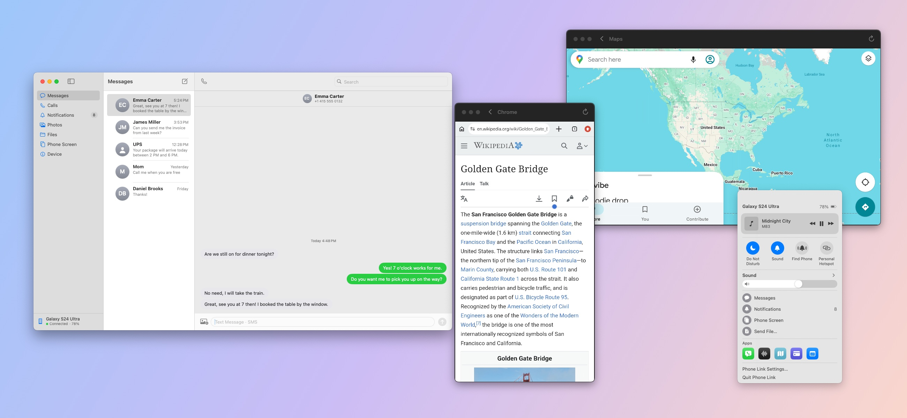
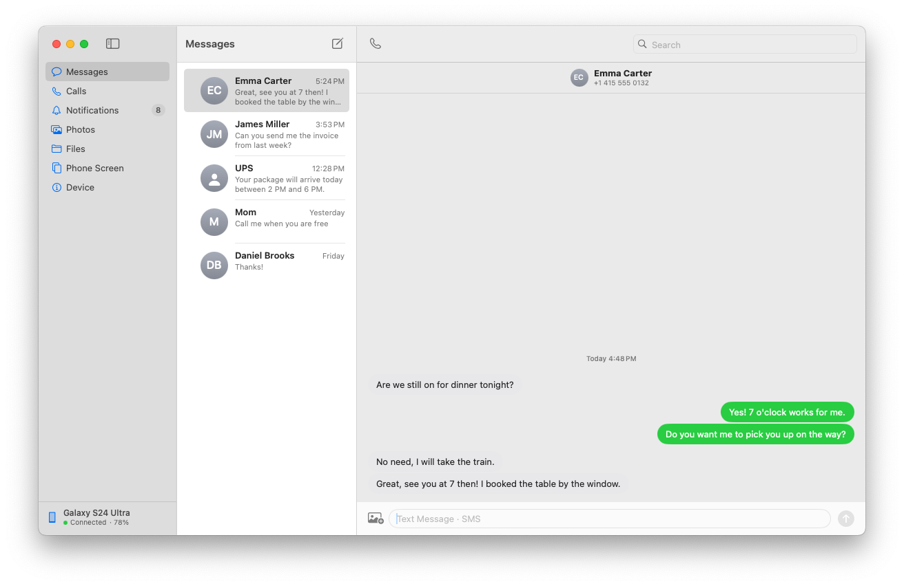
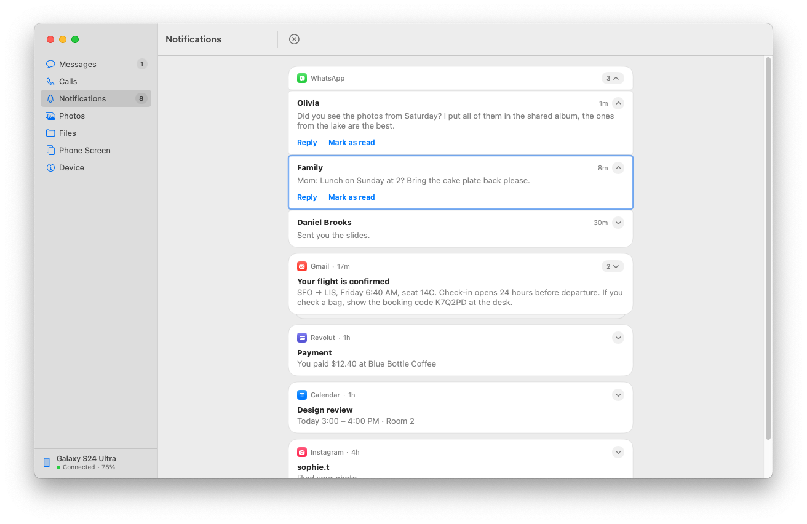
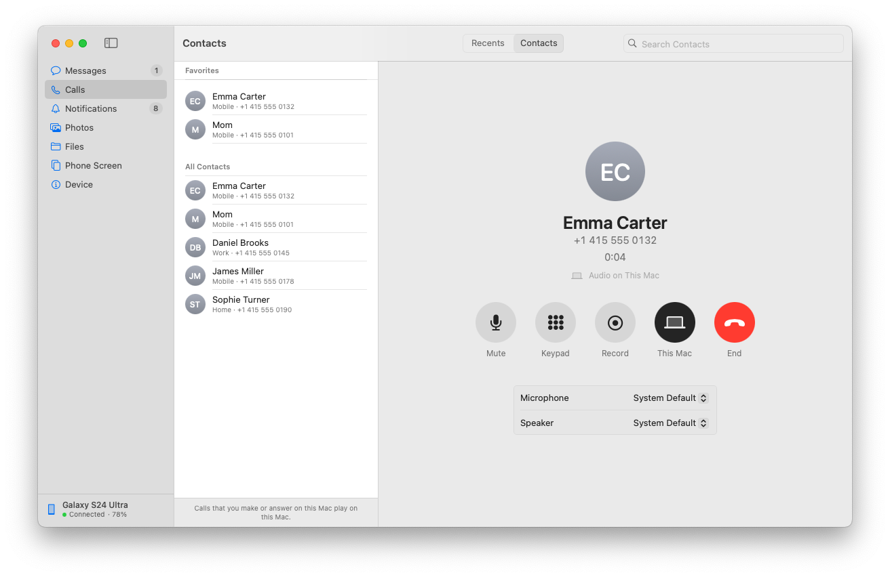
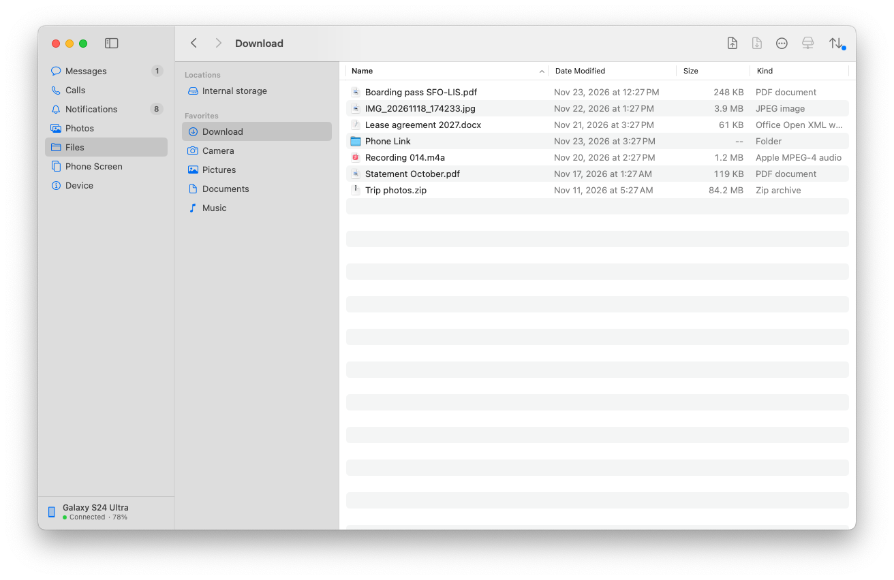

# Phone Link

Your Android phone, on your Mac. Read and send texts, take calls with the audio
on the Mac, see notifications, and open phone apps in their own windows.



No account, no cloud. The Mac and the phone talk directly over your local network.
Turn on USB or Wireless debugging on the phone to get call audio and screen
mirroring without prompts.

| | |
|---|---|
|  |  |
|  |  |

## Requirements

- Android 12 or later
- macOS 14 or later on Apple silicon
- To build: JDK 17, the Android SDK and the Xcode command line tools

## Build

The Mac app bundles the Android APK, so build Android first:

```sh
(cd android && ./gradlew assembleDebug)
(cd macos && ./build.sh)
open "macos/build/Phone Link.app"
```

Install `android/app/build/outputs/apk/debug/app-debug.apk` on the phone, open it
and follow the setup on the Mac.

## Credits

The terminal in the Android app is based on [Termux](https://github.com/termux/termux-app)
(`android/third_party/termux`).
